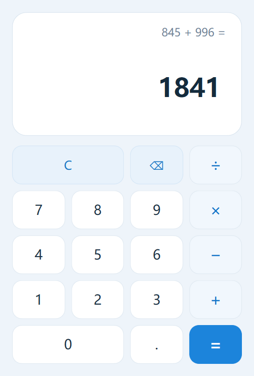
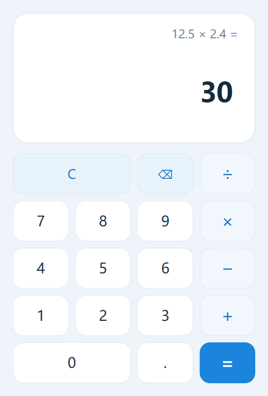
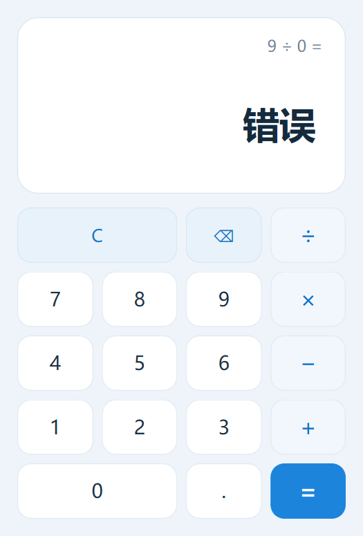

# 东莞理工学院计算机科学与技术学院

## 实验报告

| 项目 | 内容 | 项目 | 内容 |
|---|---|---|---|
| 课程名称 | Qt应用程序开发 | 学期 | 2026年秋季 |
| 实验名称 | 带键盘事件的计算器 | 实验序号 | 一 |
| 姓名 | ________________ | 学号 | ________________ |
| 班级 | ________________ | 实验地点 | ________________ |
| 实验日期 | 2026年10月27日 | 指导老师 | ________________ |

教师评语：________________________________________________________________

实验成绩：________________

## 一、实验目标

1. 熟悉 Qt Creator 开发环境，掌握 GUI 程序的创建、编译、调试和运行流程。
2. 掌握 Qt Designer 和 `.ui` 文件的使用，能够设置控件属性并安排布局。
3. 理解 Qt 信号与槽机制，掌握信号连接和槽函数的定义方式。
4. 掌握键盘事件、输入状态管理和异常输入处理，能够分析 GUI 交互逻辑。
5. 能合理使用 AI Coding 工具辅助开发，并对生成内容进行验证、调试和修改。

## 二、实验条件

- 操作系统：Windows 11 64 位
- 开发工具：Qt Creator、CMake 3.30.5、Git
- Qt 版本：Qt 6.11.2 MinGW 64 位
- 编译环境：MinGW GCC 13.1.0
- 项目地址：https://github.com/LZ431/QtCourse
- 项目目录：`experiment1_calculator`

课程文档建议 Qt 6.9.2，本机已安装的 Qt 6.11.2 与项目使用的 Qt Widgets/CMake API 兼容，因此实验环境采用 Qt 6.11.2，项目最低版本设置为 Qt 6.9。

## 三、实验内容

本次实验实现了带键盘事件的基础计算器，支持加、减、乘、除、小数、退格和清除。界面使用 Qt Designer 可编辑的 `calculatorwindow.ui` 文件设计；鼠标按钮和键盘事件都调用同一组 `CalculatorWindow` 输入函数，最终进入独立的 `CalculatorLogic` 状态机。

### 1. UI界面布局与设计

根布局采用 `QVBoxLayout`，上方为白色圆角显示区，内部用 `QVBoxLayout` 放置表达式标签和大号结果标签；下方采用 `QGridLayout` 放置 17 个按钮。按钮行列统一设置间距，窗口可随尺寸变化保持比例。

主要控件如下：

| 控件 | 对象名 | 作用 |
|---|---|---|
| 大号显示标签 | `displayLabel` | 显示当前输入或结果 |
| 表达式标签 | `expressionLabel` | 显示操作符和完整算式 |
| 数字按钮 | `digit0Button` 至 `digit9Button` | 输入 0～9 |
| 运算按钮 | `addButton`、`subtractButton`、`multiplyButton`、`divideButton` | 选择四则运算符 |
| 小数按钮 | `decimalButton` | 输入小数点 |
| 功能按钮 | `clearButton`、`backspaceButton`、`equalsButton` | 清除、退格、求值 |



### 2. 主要代码与设计说明

计算器由 `CalculatorLogic` 管理计算状态，避免把业务逻辑混在窗口事件代码中。关键状态包括：

- `m_display`：当前操作数的显示文本；
- `m_accumulator`：左操作数或中间结果；
- `m_pendingOperator`：尚未完成的运算符；
- `m_waitingForOperand`：是否正在等待第二个操作数；
- `m_justEvaluated`：是否刚完成一次等号计算；
- `m_error`：是否处于错误状态。

输入数字和小数点时，状态机根据“等待新操作数”或“继续编辑当前操作数”进入不同分支。选择运算符时，如果已有完整二元运算，则先计算前一个结果，再把结果作为新的左操作数；连续输入不同运算符时，仅替换尚未执行的运算符。按等号后，再输入数字会开始新计算，再输入运算符会从当前结果继续计算。

重复小数点通过“当前显示文本中是否已包含小数点”进行判断：

```cpp
if (m_waitingForOperand || m_justEvaluated) {
    prepareForNewEntry();
    m_display = QStringLiteral("0.");
} else if (!m_display.contains(QLatin1Char('.'))) {
    m_display.append(QLatin1Char('.'));
}
```

除零与数值溢出在状态机内统一处理，错误后按数字、小数点、退格或 `C` 可以恢复：

```cpp
case '/':
    if (rightOperand == 0.0) {
        m_display = QStringLiteral("错误");
        m_error = true;
        return false;
    }
    result = m_accumulator / rightOperand;
    break;
```

### 3. 连续运算与边界处理

本程序采用基础计算器的即时计算方式。例如依次输入 `6 + 3 × 2 =`，程序在输入乘号时先计算 `6 + 3`，再计算 `5 × 2`，结果为 `18`。

| 编号 | 测试输入 | 原程序现象 | 原因分析 | 修改方法 | 修改后结果 |
|---|---|---|---|---|---|
| 1 | `12.3.4` | 首轮直接追加方案会得到 `12.3.4`，转换时不能正确表达输入 | 输入小数时只追加字符，没有检查当前操作数是否已有小数点 | 在追加前检查 `m_display.contains('.')`，已有小数点则忽略 | 显示 `12.34` |
| 2 | `8 + * 2 =` | 若直接覆盖所有状态，可能丢失左操作数或将操作符当作右操作数 | 未区分“已有操作符并等待第二个数”与“已有完整操作数” | 增加 `m_waitingForOperand`；等待第二数时只替换操作符 | 得到 `8 × 2 = 16` |
| 3 | `9 ÷ 0 =` | 直接相除会产生无穷值并继续参与后续计算 | 浮点除法没有拦截零除数 | 执行除法前判断右操作数是否严格等于 `0.0`，进入错误状态并清空挂起运算 | 显示“错误”；输入数字后恢复 |
| 4 | `1 ÷ 0.0000000000001 =` | 开发中曾把极小非零数误判为 0，错误显示“错误” | 使用了 `qFuzzyIsNull`，其容差范围不适合作为除零条件 | 改为与 `0.0` 严格比较，并增加回归测试 | 显示 `10000000000000` |

除上述情况外，还验证了：按等号后输入新数字、按等号后继续运算、以 `5 + =` 结束、前导零、退格到空值以及连续按清除等路径。

### 4. 样式表与代码结构优化

为避免在 UI 文件中写死全部视觉效果，程序在 `CalculatorWindow` 构造函数中设置 Qt Style Sheets。显示区使用圆角白底，数字键为浅色卡片，运算键使用淡蓝色，等号键使用高对比度蓝色。所有按钮设置 `Qt::NoFocus`，防止鼠标点击后键盘焦点被按钮抢走。

控件命名采用“功能+控件类型”形式，例如 `displayLabel`、`digit7Button`、`multiplyButton`；输入处理按“数字、小数、退格、清除、运算符、求值”分别封装，鼠标与键盘只负责将事件转换成这些调用。核心计算状态集中在 `CalculatorLogic`，便于自动化测试。



### 5. 键盘事件处理

重写 `CalculatorWindow::keyPressEvent` 并完成键盘映射。键盘事件解析后调用与鼠标按钮完全相同的 `inputDigit`、`inputDecimalPoint`、`selectOperator`、`evaluate` 等成员函数，没有复制计算逻辑。

| 键盘输入 | 功能 |
|---|---|
| `0`～`9`、小键盘数字 | 输入数字 |
| `.` | 输入小数点 |
| `+`、`-`、`*`、`/` | 加、减、乘、除 |
| `x`、`X`、`×`、`÷` | 也识别为乘、除 |
| `Enter`、小键盘回车、`=` | 求值 |
| `Backspace` | 退格 |
| `Esc`、`Delete`、`C`、`c` | 全部清除 |

键盘事件关键入口：

```cpp
void CalculatorWindow::keyPressEvent(QKeyEvent *event)
{
    const int digit = event->text().front().digitValue();
    if (digit >= 0 && digit <= 9) {
        inputDigit(digit);
        return;
    }
    // 小数、运算符、等号、退格和清除也在此分流
    // 最终调用与鼠标按钮相同的成员函数
}
```

自动化测试已连续执行“键盘输入 → 鼠标点击乘号 → 键盘输入第二操作数 → 键盘回车”，结果与纯鼠标或纯键盘一致。

### 6. GitHub提交日志

实验代码提交到 `https://github.com/LZ431/QtCourse` 的 `main` 分支，实验一相关有效提交如下：

| 提交 | 内容 |
|---|---|
| `896a1a4` | 创建计算器工程和 Designer 界面布局 |
| `2471229` | 实现四则运算状态机和鼠标输入 |
| `1e7ba3d` | 增加键盘事件并复用同一套处理函数 |
| `4ba6f50` | 添加蓝色卡片式样式表 |
| `0a66d6e` | 增加边界输入和混合输入自动化测试 |
| `e62f6bb` | 修复极小非零除数误判问题 |
| 最后一个 `docs:` 提交 | 提交实验报告、截图和演示脚本 |

### 7. AI辅助开发记录

| 项目 | 记录 |
|---|---|
| 具体问题 | 如何让鼠标与键盘共用逻辑，同时正确管理连续运算和重复输入 |
| 提示词摘要 | “使用 Qt Widgets 和 `.ui` 文件实现基础计算器；鼠标与键盘复用逻辑；处理重复小数点、连续运算符、除零、按等号后继续输入” |
| AI给出的方案 | 将显示值、累加值、挂起运算符、等待操作数、刚求值和错误状态拆成独立逻辑类；键盘事件仅做映射 |
| 实际运行结果 | 项目编译成功，鼠标和键盘基础用例通过，界面可正常显示表达式与结果 |
| 存在的问题 | AI 初稿使用 `qFuzzyIsNull` 判断除数，极小非零值会被误判为零；测试还发现需要明确连续运算规则 |
| 自己的修改 | 改为严格判断 `rightOperand == 0.0`；补充小数值回归测试；拆出截图工具；逐项验证混合输入与错误恢复 |

AI 主要用于提供状态机结构草案和测试用例建议。最终代码经过本地编译、QtTest 自动测试、离屏与真实窗口截图检查，并对不合理的浮点判断进行了修正。

### 8. 测试结果

测试命令：

```text
ctest --test-dir build --output-on-failure
```

结果：`calculator_tests` 通过，`1/1` 个 CTest 测试成功，退出码为 `0`。

主要验收结果：

| 场景 | 输入 | 结果 |
|---|---|---|
| 小数加法 | `2.5 + 1.25 =` | `3.75` |
| 小数乘法 | `12.5 × 2.4 =` | `30` |
| 连续运算 | `6 + 3 × 2 =` | `18` |
| 结果后继续运算 | `2 + 3 = × 2 =` | `10` |
| 重复小数点 | `12.3.4` | `12.34` |
| 连续运算符 | `8 + * 2 =` | `16` |
| 除零 | `9 ÷ 0 =` | “错误”，输入数字后恢复 |
| 混合输入 | 键盘 `12.5 + 2 =`，再鼠标点 `×`，键盘 `2 =` | `29` |



### 9. 演示视频内容

视频按 `docs/演示视频脚本.md` 连续录制，时长为 2 分 30 秒至 3 分钟，覆盖鼠标小数运算、键盘运算、退格、清除、除零、连续运算、异常输入、混合输入和 Git 提交历史。

## 四、实验总结

本次实验完成了基于 Qt Widgets 的带键盘事件计算器。通过 `.ui` 文件组织界面，通过 `QGridLayout` 和 `QVBoxLayout` 保持控件排列，通过样式表改善视觉层次。实现过程中最重要的收获是将显示状态与计算状态分开：窗口层只负责接收事件和刷新界面，`CalculatorLogic` 负责操作数、运算符和错误恢复。

鼠标与键盘共用一个 `CalculatorWindow` 输入入口，再调用同一状态机，因此两种输入方式不会产生不同结果。自动化测试覆盖了四则运算、连续运算、重复小数点、连续运算符、除零、结果后继续输入、退格和混合输入。测试过程中发现浮点近似零判断会误伤极小非零除数，改为严格零比较后解决了问题。

AI 能较快给出状态机框架和测试清单，但它生成的内容不能直接视为正确。需要人工明确连续运算规则、检查浮点边界、编译运行并编写回归测试。最终提交保留了功能增加、样式优化、测试和问题修复的独立历史，便于追踪开发过程。

