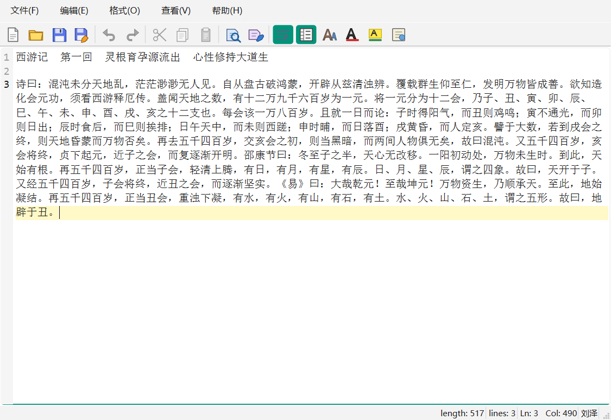
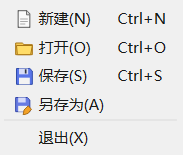
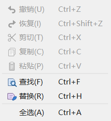
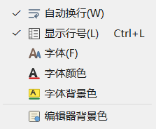
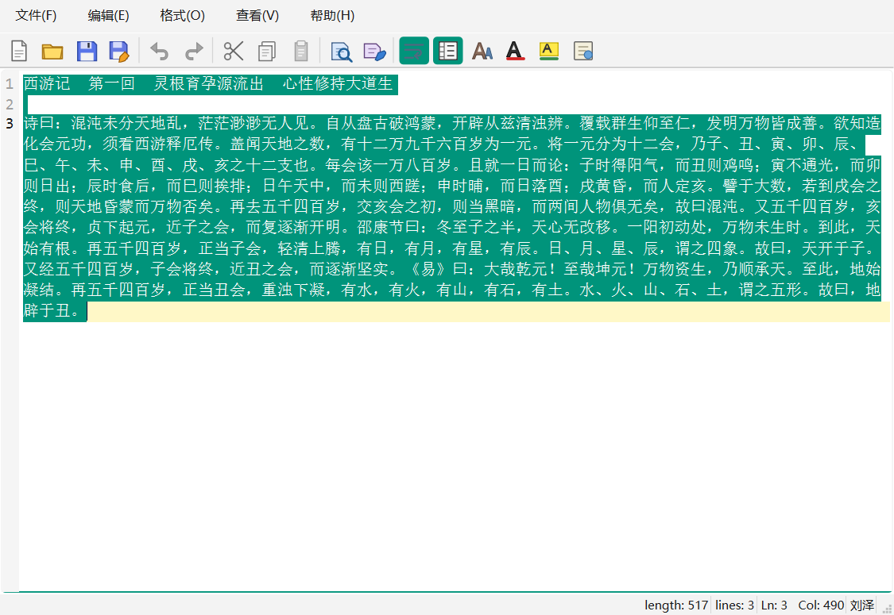
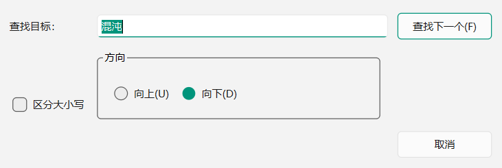
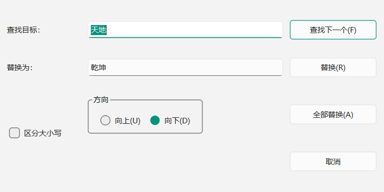

# 东莞理工学院计算机科学与技术学院

## 实验报告

| 项目 | 内容 | 项目 | 内容 |
|---|---|---|---|
| 课程名称 | Qt应用程序开发 | 学期 | 2026年秋季 |
| 实验名称 | 简单文本编辑器 | 实验序号 | 二 |
| 姓名 | 刘泽 | 学号 | 2024414290223 |
| 班级 | ________________ | 实验地点 | ________________ |
| 实验日期 | 2026年10月29日 | 指导老师 | ________________ |

教师评语：________________________________________________________________

实验成绩：________________

## 一、实验目标

1. 掌握 Qt Designer 与传统 C++ 逻辑结合的混合式 UI 设计方法。
2. 掌握 `QAction`、菜单栏和工具栏的创建、分组及快捷方式设置。
3. 掌握主窗口、普通窗口和对话框组成的多窗口程序结构。
4. 掌握 UTF-8 文本文件的读写、保存失败处理和未保存状态管理。
5. 掌握 `QPlainTextEdit`、富文本字符格式、查找替换和撤销栈的使用。
6. 能使用 AI Coding 工具辅助开发，并通过编译、自动化测试、边界测试和运行截图验证结果。

## 二、实验条件

- 操作系统：Windows 11 64 位
- 开发工具：Qt Creator、CMake、Ninja、Git
- Qt 版本：Qt 6.11.2 MinGW 64 位
- 编译器：MinGW GCC 13.1.0
- 项目目录：`experiment2_text_editor`
- 仓库：`https://github.com/LZ431/QtCourse`

课程说明中给出的 Qt 5.12.11 是参考版本。本机已安装 Qt 6.11.2，实验一也使用该版本。本工程调用的是 Qt Widgets 的稳定接口，通过 CMake 将最低 Qt 版本设为 6.9，保持课程示例所需的 `QPlainTextEdit`、`QTextDocument`、`QAction` 和 Designer 工作流。

## 三、实验内容

本实验实现一个具有菜单、工具栏、行号编辑区和状态栏的多窗口文本编辑器。主界面由 Designer 的 `mainwindow.ui` 组织，编辑控件通过 promote 提升为自定义 `CodeEditor`。关于、查找和替换分别使用独立对话框，符合文档截图所示的主窗口加辅助窗口结构。

### 1. UI 界面布局与设计

主窗口根区域为无边距 `QVBoxLayout`，只放置 `CodeEditor`，使行号栏直接贴住编辑区左边。菜单按照“文件、编辑、格式、查看、帮助”分组；工具栏按照“文件、历史、剪贴板、查找替换、格式”顺序设置分隔线。所有菜单项都使用 `QAction`，因此同一动作可以同时出现在菜单和工具栏，并保持快捷键及使能状态一致。



文件菜单包含新建、打开、保存、另存为和退出。编辑菜单包含撤销、恢复、剪切、复制、粘贴、查找、替换和全选。格式菜单包含自动换行、显示行号、字体、字体颜色、字体背景色和编辑器背景色。查看菜单可独立显示或隐藏工具栏、状态栏。







主窗口底部显示字符数、行数、光标行列和当前用户名。窗口标题格式为“文件名 - 编辑器”，内容发生变化时在文件名前增加 `*`。

### 2. 主要类与代码结构

| 类 | 职责 |
|---|---|
| `MainWindow` | 菜单动作、文件读写、格式操作、标题和状态栏维护 |
| `CodeEditor` | 继承 `QPlainTextEdit`，绘制行号和当前行高亮 |
| `FindDialog` | 输入查找目标、大小写和方向，发出查找请求 |
| `ReplaceDialog` | 查找、替换当前项和全部替换 |
| `AboutDialog` | 显示编辑器名称、开发者、学号和邮箱 |

窗口类只接收界面事件，文件处理、查找和替换均集中到公开成员函数，便于自动化测试。`MainWindow::loadFileFromPath()`、`saveFileToPath()`、`findText()` 和 `replaceAllText()` 不依赖文件选择框，可直接传入临时路径和编辑内容进行回归验证。

### 3. 关于对话框

关于对话框使用独立 `aboutdialog.ui` 设计，保持文档截图的标题、记事本图标、版本号和按钮布局。个人信息按本次要求设置为开发者“刘泽”、学号“2024414290223”、email“2227561800@qq.com”。


### 4. 文件新建、打开、保存与另存为

新建、打开和退出前都会调用 `maybeSave()`。如果文档已经修改，界面提供“保存、放弃、取消”三个选择；选择取消时中止当前操作。没有路径的文档直接执行“保存”时自动进入“另存为”。

打开文件的操作顺序是：先处理当前文档的未保存状态，再选择文件，然后检查文件是否存在、是否为普通文件、是否超过 32 MB，并拒绝包含 NUL 字节的二进制内容。读取成功后使用 UTF-8 解码，必要时回退到本地编码；失败时保留当前编辑器内容。

保存使用 `QSaveFile` 先写临时文件，全部写入成功后才原子替换目标文件，避免磁盘写入中断破坏原文件。

```cpp
QSaveFile file(path);
if (!file.open(QIODevice::WriteOnly))
    return reportSaveError(file.errorString());

const QByteArray data = m_editor->toPlainText().toUtf8();
if (file.write(data) != data.size()) {
    file.cancelWriting();
    return false;
}
return file.commit();
```

### 5. 编辑动作与使能状态

撤销、重做直接连接到 `QPlainTextEdit` 的编辑栈；剪切、复制、粘贴也复用标准编辑行为。`copyAvailable`、`undoAvailable`、`redoAvailable` 和剪贴板 `dataChanged` 信号用于更新 `QAction`：

- 只有存在选区时启用剪切和复制；
- 剪贴板含文本时启用粘贴；
- 只有撤销栈或重做栈可用时启用对应动作；
- 选择全部文本后，工具栏中的剪切和复制图标恢复可用。



### 6. 字体、颜色、背景色与自动换行

字体使用 `QFontDialog` 选择，颜色使用 `QColorDialog` 选择。若存在选区，字符格式合并到选区；若没有选区，则设置当前输入位置的格式，后续键入沿用该设置。

编辑器背景色通过 `QPalette::Base` 设置，同时自动生成较深或较浅的行号栏颜色，避免深色背景下行号不可读。自动换行在 `WidgetWidth` 与 `NoWrap` 两种模式间切换，行号栏在自动换行时只对逻辑行编号。

### 7. 行号与状态栏

`CodeEditor` 通过 `blockCountChanged`、`updateRequest` 和 `cursorPositionChanged` 维护行号栏：

```cpp
connect(this, &QPlainTextEdit::blockCountChanged,
        this, &CodeEditor::updateLineNumberAreaWidth);
connect(this, &QPlainTextEdit::updateRequest,
        this, &CodeEditor::updateLineNumberArea);
connect(this, &QPlainTextEdit::cursorPositionChanged,
        this, &CodeEditor::highlightCurrentLine);
```

行号栏宽度根据最大行号位数计算，滚动时同步平移。当前行使用浅黄色背景突出显示。状态栏在文本变化和光标移动时刷新字符数、逻辑行数、`Ln` 和 `Col`。

### 8. 查找对话框

查找对话框包含查找目标、区分大小写、向上/向下和“查找下一个”。连续查找从当前选区末端开始，避免原地重复命中。到达文档边界后回到另一端继续查找；整个文档均未命中时显示“未找到”，不会修改文档。



### 9. 替换对话框与全部替换

替换当前项先检查当前选区是否与目标一致；一致时替换，否则先查找下一个。全部替换循环调用 `QTextDocument::find()`，使用 `beginEditBlock()/endEditBlock()` 将整批替换合并为一次撤销操作，并显示替换数量或“未找到”。



### 10. 定时自动保存

自动保存定时器每 60 秒触发一次。只有“已经具有文件路径”且“文档已修改”时才自动写入，成功后状态栏提示“已自动保存”，失败则提示“自动保存失败”。新建但尚未指定路径的文档不会静默落到未知位置，仍由关闭提示或另存为要求用户确认目标路径。

## 四、测试结果

自动化测试命令：

```text
ctest --test-dir build --output-on-failure
```

结果为 `1/1` 测试程序通过，退出码 0。测试程序包含 7 个功能测试，覆盖以下内容：

| 编号 | 场景 | 输入或操作 | 期望结果 | 实际结果 |
|---|---|---|---|---|
| 1 | UTF-8 保存与重开 | 三行中文文本，写入临时 `.txt` 后清空再打开 | 文本和行数一致，修改标记清除 | 通过 |
| 2 | 不存在文件 | 打开不存在的 `missing.txt` | 返回失败并说明文件不存在，编辑器不变 | 通过 |
| 3 | 二进制文件 | 内容包含 NUL 字节的 `.dat` | 拒绝打开，提示不是有效文本文件 | 通过 |
| 4 | 连续查找与环绕 | 从文末向下查找首个 `Alpha`，再切换大小写和方向 | 从文末环绕到首项，反向回到前项 | 通过 |
| 5 | 全部替换及未找到 | 大小写不敏感地把 3 个 `alpha` 替换为 `文本`，再替换不存在的词 | 第一次返回 3，第二次返回 0 且文本不变 | 通过 |
| 6 | 行号与动作状态 | 隐藏行号；选中、剪切、撤销和重做 | 编辑区边距变化，动作能力与历史状态一致 | 通过 |
| 7 | 未保存关闭提示 | 修改文档后关闭，依次选择取消和放弃 | 取消时窗口保留，放弃时允许关闭 | 通过 |

另进行人工运行验证：

1. 修改已有文件后关闭，出现保存/放弃/取消提示，取消后窗口继续保留。
2. 查找不存在的字符串时显示“未找到”，文档内容不改变。
3. 全部替换后一次撤销即可恢复整批内容。
4. 切换自动换行和行号显隐后，编辑区布局正常刷新。
5. 字体、字体颜色、字体背景色和深色编辑器背景均可正常应用。

## 五、错误与边界分析

### 1. 修改标记与窗口标题

最初直接依赖 `setWindowModified()`，但自绘标题没有 `[*]` 占位符，Qt 无法自动替换。改正为监听 `QTextDocument::modificationChanged` 并手工组合 `*`、文件名和“编辑器”，显示结果稳定且不依赖平台标题栏规则。

### 2. 连续查找边界

若每次都从文档起点重新查找，点击“查找下一个”会一直选中第一处。实现中选择“当前选区末端”作为下一轮起点，只有本轮失败后才环绕到另一端。向后查找则使用选区起点并以文末作为环绕位置。

### 3. 全部替换后的撤销

逐次替换默认会形成很多独立撤销步骤。通过 `QTextCursor::beginEditBlock()` 和 `endEditBlock()` 包裹整个替换循环，用户只需撤销一次即可恢复替换前的全部内容。

### 4. 异常文件破坏当前内容

打开文件前先完成所有验证，只有解码成功后才调用 `setPlainText()`。因此不存在文件、超限文件、含 NUL 的二进制文件或读取失败不会覆盖用户正在编辑的内容。

## 六、AI 辅助开发记录

| 环节 | 记录 |
|---|---|
| 问题 | 如何让菜单、工具栏和快捷键共用一套状态，同时实现连续查找、替换全部和未保存保护 |
| 提示词摘要 | “使用 Qt Widgets 和 Designer 完成实验二文本编辑器；主窗口加查找、替换、关于对话框；支持文件操作、字符格式、行号、自动换行、动作使能、查找替换环绕和 60 秒自动保存；给出可测试结构和边界测试。” |
| AI 方案 | 建议使用 `QAction` 统一菜单与工具栏，主窗口集中文件状态，`CodeEditor` 派生 `QPlainTextEdit` 绘制行号，查找失败后才环绕，全部替换使用编辑块 |
| 运行验证 | Qt 6.11.2 编译成功；QtTest 的 7 个功能测试通过；离屏生成主界面、菜单、对话框和选区截图检查布局 |
| 发现的问题 | AI 初稿直接用固定起点实现“查找下一个”会反复命中首项；用 `setWindowModified()` 更新自绘标题会产生占位符警告；逐项替换导致撤销粒度过细 |
| 自己的修改 | 把下一轮起点改成选区末端；改为手工更新带 `*` 的标题；将全部替换包裹为一个撤销块；补充缺失文件、二进制文件和动作状态测试 |

AI 主要提高了界面 XML、Qt API 选型和测试清单的整理效率。最终结果通过本地编译、CTest、真实窗口截图和人工交互检查确认，没有直接把生成代码视为正确结果。

## 七、Git 提交记录

实验二在 `main` 分支中提交，提交信息与真实日志保持一致。提交内容包括完整编辑器工程、QtTest 回归测试、截图生成工具、运行截图和实验报告。

```text
5e7e4d9 feat: add simple text editor with complete editing workflow
e50c032 docs: add experiment notes and runtime screenshots
27177eb test: verify unsaved close prompt and cancel behavior
```

## 八、实验总结

本次实验完成了从单窗口计算器到多窗口文本编辑器的过渡。主窗口使用 Designer 组织菜单和 Action，编辑区使用派生控件实现行号和当前行高亮；关于、查找和替换保持独立窗口，文件状态由主窗口统一管理。

实现中最重要的是把“内容是否修改”和“是否已有保存路径”分开处理：标题只反映修改状态，未命名文档保存时进入另存为，定时自动保存只处理已有路径的修改文档。查找、替换和文件读写都经过可复用的成员函数，使功能不仅能在界面中运行，也能通过 QtTest 覆盖异常场景。

通过本实验进一步理解了 Qt 的信号槽、Action 状态、富文本光标、文档撤销栈和 `QSaveFile` 原子写入。AI 可以快速生成界面与代码草案，但边界行为仍需通过实际运行、自动化和人工测试逐项验证。

